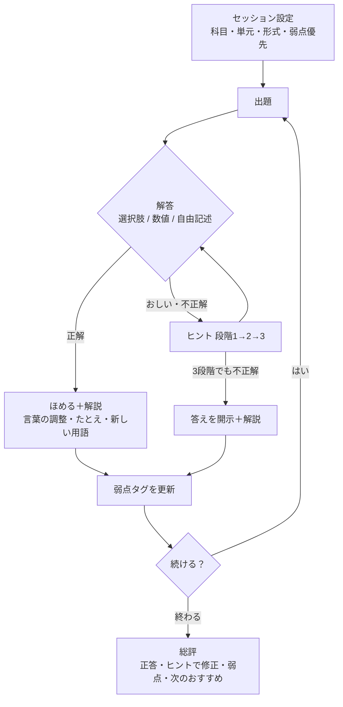

# ギャル先生モード 要件定義（v0.1 たたき台）

紙もペンもない場所で、スマホひとつで「AIギャル先生」と一問一答を繰り返し、理解を確かめながら練習するモード。
denken3-drill に新しいモードとして追加する。

- 作成日：2026-11-19
- 状態：MVP 実装済み（`gal.js`）。残りは §11

## 1. 決まっていること

| 項目 | 決定 |
| --- | --- |
| 作る場所 | denken3-drill に「ギャル先生」モードを追加（既存の PWA・KaTeX・SVG 図・問題 JSON・学習記録を流用） |
| AI の呼び出し | 自分の Anthropic API キーを端末に保存し、ブラウザから Messages API を直接呼ぶ（サーバなし） |
| 使う人 | 自分だけ（ログイン・課金・利用規約は不要） |
| 出題のもと | ミックス：基本は問題 JSON から出題し、AI が解説・ヒント・深掘り質問を担当。ときどき AI が類題を作る |
| 技術 | 既存どおり依存なしの素の HTML / CSS / JS、GitHub Pages で配信 |
| モデル | 既定は Opus 5.5（入力 4 ドル / 出力 20 ドル、100 万トークンあたり）。設定で変更可 |
| 料金 | 月の上限（目安）を設定。既定 20 ドル |
| 数式入力 | 入力欄の上に数式キー（π・√・√3 など）を出す |
| 弱点の記録 | ふつうの「苦手克服」とは別に持つ |
| 口調の調整 | なし（ギャル口調固定） |

## 2. 利用シーンと前提

- 電車・待ち時間・寝る前など、片手で操作する。紙とペンは使えない。
- 入力は「選択肢をタップ」が中心。自由記述は短い文（説明問題・理由・計算の流れ）。
- 計算はアプリ内で完結させる（電卓を別に開かない）。
- 通信が切れることがある。AI が使えないときも練習は続けられること。

## 3. 学習フロー

2026-11-17〜18 のギャル先生との一問一答（交流・直流回路）の流れをそのままアプリにする。



- 出題は「説明問題」と「計算問題」を交互に出すのが既定。本番形式（五肢択一）だけのセッションも選べる。
- 間違えても答えはすぐ言わない。ヒントで粘って自力で直させる。
- 正解でも、言葉づかいの不正確さ（例：磁束と磁束密度、「変化が大きい」と「速い」）は △ として指摘する。
- 初めて出てくる記号・単位は「読み・意味・由来」をカードで出す。

## 4. 機能要件

### 4.1 MVP（最初に作る）

| ID | 機能 | 内容 |
| --- | --- | --- |
| F-01 | セッション画面 | チャット形式。先生の発言は Markdown＋KaTeX＋SVG 図。ストリーミングで少しずつ表示 |
| F-02 | 解答入力 | ①選択肢（2〜5 個、タップで即送信） ②数値＋単位（数字キーパッド、√・π・分数のボタン、単位チップ） ③自由記述（1〜3 行） |
| F-03 | 採点 | 選択式と数値は**アプリ側で採点**（AI に正誤を任せない）。説明問題の自由記述は AI が ○ / △ / × で評価 |
| F-04 | ヒント段階 | 1 段目：方向づけ、2 段目：具体的な手がかり、3 段目：ほぼ答え。3 段目でも不正解なら答えを開示 |
| F-05 | 出題ソース（問題 JSON） | 既存の問題 JSON（`denken3-drill/v1`）から出題。選択肢・正解・解説・図はそのまま使い、AI は会話（ヒント・解説・深掘り）を担当 |
| F-06 | 弱点タグ | 間違え方にタグを付けて記録（例：`P/S取り違え`、`√3忘れ`、`進み遅れ逆`、`和と差`）。総評と次回出題に使う |
| F-07 | 総評 | セッション終了時に、問題ごとの結果（○ / ヒントで修正 / ×）と新しい弱点を表で出す |
| F-08 | 設定 | API キーの入力・削除・接続テスト、モデル選択、1 セッションの最大往復数 |
| F-09 | オフライン | AI が使えないときは、既存のドリル（4 択＋解説）にそのまま切り替える |

### 4.2 次の段階

| ID | 機能 | 内容 |
| --- | --- | --- |
| F-10 | AI 類題 | 解いた問題の数値や条件を変えた類題を AI が作る。**計算問題は §6.3 の検算を通ったものだけ出す** |
| F-11 | 用語辞書 | セッション中に出た記号・単位・用語（読み・意味・由来）を自動でためて、あとで一覧できる |
| F-12 | 弱点リベンジ | 弱点タグが多いテーマから優先して出題するモード。既存の「苦手克服」と並べる |
| F-13 | 学習ログ書き出し | セッションの記録を Markdown / JSON で書き出す（PDF 化はその先） |

### 4.3 後回し

- AI が回路図（SVG）を描く（品質と安全性の検証が必要）。当面は問題 JSON の図だけ使う。
- 音声入力・読み上げ。
- 複数端末での同期。

## 5. 先生（AI）のふるまい

system プロンプトで次を固定する。

- **口調**：ギャル口調。新しいことは大胆なたとえで説明する（扇風機、ブランコ、山登り、トラックなど）。
- **教え方**：
  - 答えはすぐ言わない。ヒントは §4.1 F-04 の 3 段階。
  - 正解でも、用語のあいまいさは訂正する。
  - 公式は「なぜそうなるか」から説明させる。
  - 間違いの原因を本人に言語化させる（例：「電源が 1 つのときの癖で I₁ = I₂ + I₃ と書いた」）。
- **してはいけないこと**：正誤の判定を勝手に変える（選択式・数値はアプリの採点が正）、問題文にない数値を作る、根拠のない断定。

## 6. AI 連携の設計

### 6.1 呼び出し

- `POST https://api.anthropic.com/v1/messages` をブラウザから `fetch` で直接呼ぶ。
- ヘッダ：`x-api-key`、`anthropic-version`、`content-type`、`anthropic-dangerous-direct-browser-access: true`（ブラウザからの直接呼び出しに必要）。
- Opus 5.5 は思考が常にオンなので、`tool_choice` は強制（`tool`）ではなく `auto` にする。ツールを使わず文章だけ返ってきた場合も、その文章を先生の発言として表示する。
- ストリーミング（SSE）で表示を始める。目標：最初の文字が 2 秒以内。

### 6.2 出力の形

自由文だけにせず、ツール呼び出し（JSON）で構造化して受け取る。アプリはこの JSON で画面を組む。

```json
{
  "kind": "feedback",
  "verdict": "partial",
  "message": "入口は合ってる〜！でも…（Markdown＋$KaTeX$）",
  "hint_level": 1,
  "weak_tags": ["P/S取り違え"],
  "new_terms": [{ "symbol": "var", "reading": "バール", "meaning": "無効電力の単位", "origin": "volt-ampere reactive" }],
  "next": { "type": "ask_again" }
}
```

- `kind`：`question` / `feedback` / `hint` / `explanation` / `summary`
- `verdict`：`correct` / `partial` / `wrong`（自由記述のときだけ AI が決める）
- AI が出す問題（F-10）は、選択肢・正解・**検算用の式**を持つ。

### 6.3 計算の正しさ

- 選択式・数値問題の正解は問題 JSON にあるものを使う。
- AI 類題は、AI が出した「検算用の式」（例：`15000 / (sqrt(3) * 200)`）をアプリ内の安全な数式評価器で計算し、正解の選択肢と有効数字 3 桁で一致しなければ破棄して作り直す。
- 数値入力の採点は相対誤差 1% 以内を正解とする（端数処理の確認は別に △ で指摘）。

### 6.4 送る文脈

- 毎回送る：system プロンプト、出題中の問題（本文・選択肢・正解・解説）、直近の往復、弱点タグの上位。
- セッションが長くなったら古い往復は要約して送る（トークンを抑える）。
- 送らない：API キー以外の個人情報（そもそも持たない）。

### 6.5 モデル

- 設定で選べる。既定は応答の速い軽いモデル、類題生成など重い処理だけ上位モデルを使う案。
- 候補の例：`claude-haiku-5-5`（会話・ヒント）、`claude-sonnet-5-5`（類題生成）。料金と速さを試してから決める（§11）。

## 7. データ

既存の `localStorage`（キー `denken3-drill:v1`）に `gal` を追加する。

```js
gal: {
  sessions: [{ id, startedAt, scope, items: [{ qid, result: 'correct'|'hinted'|'wrong', hints, tags }], summary }],
  weakTags: { 'P/S取り違え': { count, lastAt, lastQid } },
  terms: { 'var': { reading, meaning, origin, firstAt } },
  settings: { model, maxTurns, hintMax: 3 }
}
```

- API キーは**別のキー**（`denken3-drill:secret`）に保存し、バックアップの書き出しには含めない。
- 会話の全文は保存しない（容量のため）。総評と結果だけ残す。

## 8. 画面

| 画面 | 内容 |
| --- | --- |
| ホーム | 「ギャル先生」ボタンを追加。API キー未設定なら設定へ案内 |
| セッション設定 | 科目・単元・形式（交互 / 説明だけ / 計算だけ / 本番形式）・問題数・弱点優先 |
| セッション | チャット＋下部の入力エリア（選択肢・数値キーパッド・自由記述を切り替え） |
| 総評 | 結果の表、新しい弱点、次のおすすめ |
| 設定 → AI | API キー、接続テスト、モデル、往復数の上限 |

## 9. 非機能要件

- **操作**：片手・親指で届く位置に入力エリア。ボタンの高さ 44px 以上。ダークモード対応（既存の配色規約に従う）。
- **速度**：最初の文字が 2 秒以内（ストリーミング）。
- **オフライン**：アプリ本体は既存どおり Service Worker でキャッシュ。AI が使えないときは F-09。
- **安全**：AI の出力 HTML はエスケープし、SVG は既存の `sanitizeSvg` を通す。API キーは端末の外へ出さない（Anthropic への送信を除く）。
- **費用**：1 セッションの最大往復数と、1 回の `max_tokens` を設定で制限する。

## 10. 受け入れ基準（MVP）

1. API キーを入れて接続テストが成功する。キーを削除すると AI 機能が止まり、既存のドリルは使える。
2. 問題 JSON の 1 問について、不正解 → ヒント 1 → ヒント 2 → 正解 の流れが最後まで動く。
3. 選択式の正誤は、AI の発言にかかわらずアプリの採点どおりに表示される。
4. 説明問題の自由記述に ○ / △ / × と短いコメントが返る。
5. 先生の発言の数式（KaTeX）と図（SVG）が正しく表示される。
6. セッション終了で総評が表示され、弱点タグが保存される。
7. 機内モードでギャル先生を開くと、既存のドリルに切り替わる案内が出る。

## 11. 決まったこと・残り

決まったこと（2026-11-19）：数式は独自のキー（π・√3 を打ちやすく）／弱点は苦手克服と別／既定モデルは Opus 5.5、月の上限は目安 20 ドル／口調の調整はなし。

残り：

- 数値＋単位の入力（AI 類題 F-10 と一緒に作る）。
- AI 類題の検算（§6.3）、用語辞書（F-11）、学習ログの書き出し（F-13）。
- 料金の目安は公表単価からの概算。実際の請求と比べて、ずれが大きければ係数を見直す。
